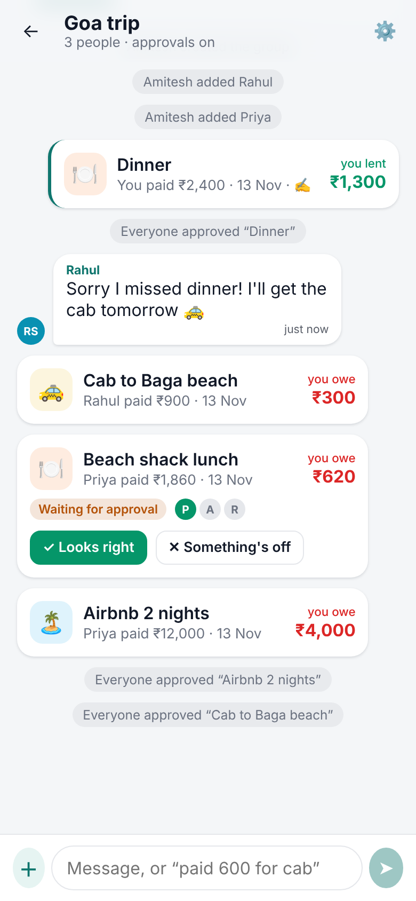
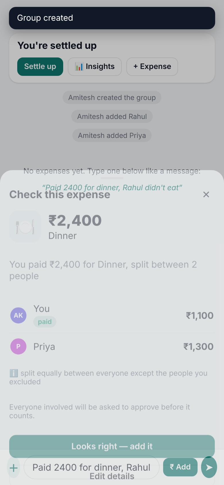
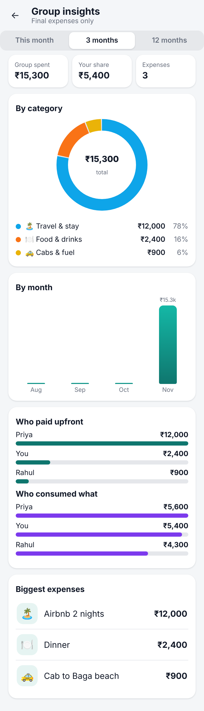

# Hisaab Web

Mobile-first React PWA for [Hisaab](https://github.com/belikeamitesh/hisaab-api): split expenses with friends, type them in plain words, approve together, settle with any UPI app.

- **Home**: what you'll get back / what you owe, groups, friends, balances per person across groups
- **Group**: a chat-style timeline of expenses, payments, messages and activity. Type `paid 600 for cab` in the message box and tap **₹ Add** to get a parsed preview.
- **Expense form**: split equally, by ₹, by % or by shares, with extras and multiple payers, plus a live check that the numbers add up
- **Approvals**: approve or dispute expenses that include you
- **Settle up**: one-tap `upi://pay` links, "I've paid" → receiver confirms, reminders
- **Insights**: category donut, monthly bars, who paid and who consumed. Charts are plain SVG, with no chart library.
- **Profile**: UPI ID and tokens for AI assistants (MCP), with copy-paste config for Claude Code and Cursor
- Installable PWA, dark mode, works on phones and desktop

The only runtime dependencies are `react` and `react-dom`. A ~40-line router and the hand-written CSS keep the bundle small.

## Run

```bash
cp .env.example .env        # VITE_API_URL=http://localhost:8080
npm install
npm run dev                 # http://localhost:5173
```

Start the API with `ALLOW_MEMORY_STORE=true DEV_RETURN_LINK=true go run ./cmd/server` and sign in using the dev-mode link button.

## Deploy (Cloudflare Pages, free)

Use build command `npm run build`, output directory `dist`, and environment variable `VITE_API_URL=https://<your-api>.onrender.com`.
`public/_redirects` handles SPA routes. Set the API's `APP_URL` and `ALLOWED_ORIGINS` to the Pages URL.

## Screenshots

| Group timeline | Plain-words expense | Insights |
|---|---|---|
|  |  |  |
